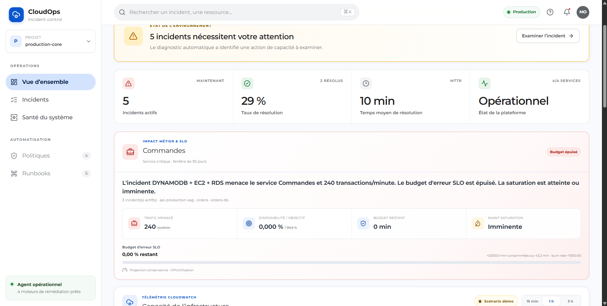
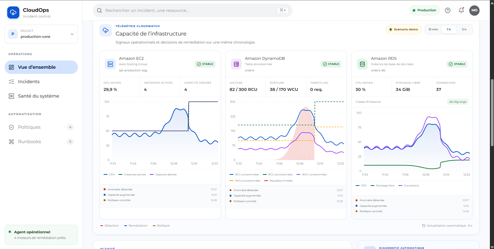
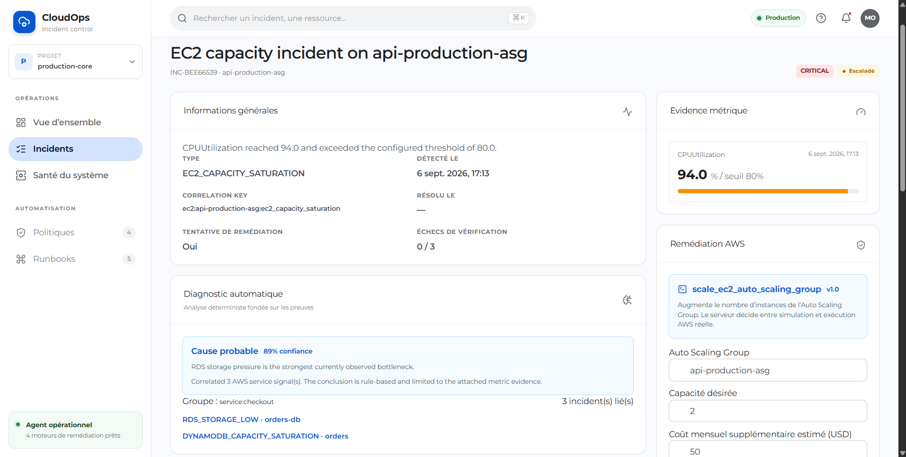
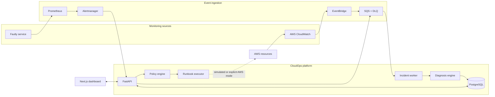

# CloudOps AI Incident Agent

<div align="center">

**An event-driven platform for detecting, diagnosing, and safely remediating AWS incidents.**

[](https://github.com/mohamed07elmoukh-cpu/cloudops-ai-incident-agent/actions/workflows/ci.yml)
[](https://github.com/mohamed07elmoukh-cpu/cloudops-ai-incident-agent/actions/workflows/security.yml)


[Features](#key-features) · [Architecture](#architecture) · [AI engine](#ai-assisted-diagnosis) · [Quick start](#quick-start) · [Documentation](#documentation)

</div>

## Overview

CloudOps AI Incident Agent is a full-stack incident-management platform built to reduce the time between an infrastructure alert and a safe, auditable recovery.

The platform ingests Prometheus or native AWS CloudWatch alerts, correlates related EC2, DynamoDB, and RDS signals, identifies a probable root cause, estimates business and cost impact, selects a versioned runbook, applies safety policies, and verifies recovery after remediation.

It runs locally as a complete eight-service environment and supports an explicit AWS mode for real capacity actions. All remediation is simulated by default.

## Product preview

The layout below reserves space for the final product screenshots. See [`docs/screenshots`](docs/screenshots/README.md) for the expected filenames and capture guidelines.

<table>
  <tr>
    <td width="50%" align="center">
      <strong>Operations overview</strong><br><br>
      📷 <code>docs/screenshots/dashboard-overview.png</code><br><br>
      <sub>KPIs, incident trend, platform health, and recent activity</sub>
    </td>
    <td width="50%" align="center">
      <strong>Live infrastructure</strong><br><br>
      📷 <code>docs/screenshots/live-infrastructure.png</code><br><br>
      <sub>EC2, DynamoDB, and RDS metrics with lifecycle markers</sub>
    </td>
  </tr>
  <tr>
    <td colspan="2" align="center">
      <strong>Incident diagnosis and remediation</strong><br><br>
      📷 <code>docs/screenshots/incident-detail.png</code><br><br>
      <sub>Evidence, correlated signals, probable root cause, runbook, and verification</sub>
    </td>
  </tr>
</table>

<!--
When the screenshots are ready, replace the table above with:




-->

## Key features

- **Event-driven detection** — receives Alertmanager webhooks and native CloudWatch alarm transitions through EventBridge and SQS.
- **Cross-service correlation** — groups related EC2, DynamoDB, and RDS alerts within a shared application context.
- **Explainable diagnosis** — produces an evidence-backed probable root cause, confidence score, and diagnostic summary.
- **Guarded remediation** — executes versioned runbooks only after allowlist, cost, cooldown, idempotency, and approval checks.
- **Recovery verification** — confirms that service metrics recovered and escalates after repeated failed checks.
- **Business impact and SLOs** — estimates transactions at risk, availability, error-budget burn, and time to saturation.
- **Operational dashboard** — provides live metrics, search, filters, timelines, incident details, remediation, rollback, and component health.
- **Complete audit trail** — persists incidents, evidence, processed events, decisions, and remediation executions in PostgreSQL.
- **Production-oriented delivery** — includes Docker images, Terraform, CI, security scanning, and GHCR release workflows.

## Architecture



### Incident lifecycle

```text
Signal -> Detect -> Correlate -> Diagnose -> Policy gate -> Remediate -> Verify
                                                                     |        |
                                                                     + Rollback/Escalate
```

The ingestion path uses strict CloudEvents, stable delivery identifiers, atomic persistence, and an SQS dead-letter queue. A message is acknowledged only after its database transaction succeeds.

## AI-assisted diagnosis

The current intelligence layer is intentionally **deterministic and explainable**. It correlates infrastructure signals, ranks likely root causes, attaches the metric evidence used in the decision, and calculates a confidence score. This provides an auditable baseline that remains available even when no model endpoint is configured.

The AI roadmap adds Amazon Bedrock/LLM reasoning on top of that baseline to:

- summarize incidents and correlated evidence in natural language;
- propose alternative root-cause hypotheses;
- retrieve relevant runbooks and recommend the safest response;
- generate post-incident reports and operator-facing explanations.

Model output will remain advisory: it must conform to structured schemas and pass the existing policy engine before any action can run. Logs and external evidence are treated as untrusted input to reduce prompt-injection risk, and the deterministic engine remains the fallback.

> **Current scope:** evidence-based correlation, confidence scoring, and automated diagnosis are implemented. Bedrock, LangGraph, and LLM inference are planned extensions and are not required to run the platform.

## Technology stack

| Layer | Technologies |
| --- | --- |
| Frontend | Next.js 16, React 19, TypeScript, TanStack Query, Recharts |
| Backend | Python 3.12, FastAPI, Pydantic, SQLAlchemy, Alembic |
| Data and messaging | PostgreSQL 16, Amazon SQS, LocalStack, CloudEvents |
| AWS integration | CloudWatch, EventBridge, EC2 Auto Scaling, DynamoDB, RDS, AWS Pricing API |
| Observability | Prometheus, Alertmanager, health and metrics endpoints |
| Infrastructure | Docker Compose, Terraform, GitHub Actions, GHCR |
| Quality and security | Pytest, Playwright, Ruff, mypy, ESLint, Trivy |

## Quick start

### Prerequisites

- Docker Desktop with Docker Compose
- Git
- At least 4 GB of available memory for the local stack

### Run the complete platform

```bash
git clone https://github.com/mohamed07elmoukh-cpu/cloudops-ai-incident-agent.git
cd cloudops-ai-incident-agent
docker compose up -d --build
```

Wait until the services are healthy, then open:

| Service | URL |
| --- | --- |
| Operations dashboard | <http://localhost:3000> |
| CloudOps API and OpenAPI | <http://localhost:8000/docs> |
| Worker health and metrics | <http://localhost:8002/health> |
| Fault-injection service | <http://localhost:8001> |
| Prometheus | <http://localhost:9090> |
| Alertmanager | <http://localhost:9093> |

Check the stack or stop it with:

```bash
docker compose ps
docker compose down
```

Persistent PostgreSQL, Prometheus, Alertmanager, and LocalStack data is kept in named Docker volumes. Use `docker compose down -v` only when you intentionally want to delete it.

## Run the demo

Start a bounded CPU fault:

```bash
curl -X POST "http://localhost:8001/chaos/cpu?duration_seconds=45"
```

The full path is automatic:

```text
Faulty service -> Prometheus -> Alertmanager -> FastAPI webhook
               -> LocalStack SQS -> incident worker -> PostgreSQL -> dashboard
```

Prometheus raises `DemoServiceHighCPU` after 15 seconds. Open the dashboard to inspect the incident, evidence, lifecycle timeline, and suggested runbook. The local executor is safe by default and does not modify AWS resources.

An incident can also be created directly through the API:

```bash
curl -X POST http://localhost:8000/api/detection/evaluate \
  -H "Content-Type: application/json" \
  -d '{"source":"demo-service","metric_name":"cpu_usage_percent","value":92,"threshold":85,"timestamp":"2026-08-24T17:00:00Z"}'
```

## AWS remediation and safety

The platform includes guarded runbooks for:

| Incident | Remediation |
| --- | --- |
| EC2 capacity saturation | Increase Auto Scaling Group desired capacity |
| DynamoDB capacity saturation | Increase provisioned read/write capacity |
| RDS low storage | Increase allocated storage or autoscaling limit |
| RDS compute saturation | Change the DB instance class after human approval |

Real AWS mutations are disabled unless `REMEDIATION_MODE=aws` is explicitly configured. Before execution, the platform validates:

- runbook/action allowlists and validated parameter schemas;
- server-side AWS Pricing estimates and monthly cost ceilings;
- per-resource cooldowns and idempotency keys;
- human approval for RDS compute changes;
- rollback feasibility and the previous resource state.

See [`docs/aws-remediation.md`](docs/aws-remediation.md) for IAM permissions, configuration, API examples, rollback behavior, and production caveats.

## Local development

### Backend

```bash
python -m venv .venv

# Windows PowerShell
.\.venv\Scripts\Activate.ps1

# Linux or macOS
source .venv/bin/activate

python -m pip install -e ".[dev]"
pytest -q
ruff check .
mypy .
```

### Dashboard

```bash
cd apps/dashboard
npm ci
npm run dev
```

Quality checks:

```bash
npm run lint
npm run typecheck
npm run build
npm run test:e2e
```

## Configuration

Docker Compose provides safe local defaults. The main production-facing variables are:

| Variable | Purpose | Default |
| --- | --- | --- |
| `DATABASE_URL` | PostgreSQL connection URL | Local Compose database |
| `INCIDENT_QUEUE_URL` | SQS incident queue | LocalStack queue |
| `REMEDIATION_MODE` | `simulated` or `aws` executor | `simulated` |
| `CLOUDWATCH_METRICS_MODE` | Demo or real CloudWatch metrics | `demo` |
| `AWS_PRICING_MODE` | Demo or real AWS pricing | `demo` |
| `REMEDIATION_MAX_MONTHLY_COST_DELTA_USD` | Global remediation cost ceiling | `500` |
| `AWS_REGION` | AWS region used by adapters | `us-east-1` |
| `AWS_CORRELATION_TAG_KEY` | Resource tag used to group related incidents | Not set |

Never commit production AWS credentials. Prefer temporary credentials or workload identities with least-privilege policies.

## Testing and CI/CD

The repository includes unit, contract, integration, end-to-end, and live-stack tests. GitHub Actions automatically runs:

- Python linting, strict type checking, tests, and coverage;
- frontend linting, TypeScript checks, production build, and Playwright tests;
- Terraform formatting and validation;
- Docker builds and Trivy vulnerability scans;
- scheduled dependency, secret, and infrastructure-as-code scanning;
- versioned container publication to GitHub Container Registry.

Some integration and live-stack tests require PostgreSQL, LocalStack, or the complete Docker Compose environment and are skipped when those services are unavailable.

## Project structure

```text
.
├── apps/
│   ├── api/                  # FastAPI application
│   ├── dashboard/            # Next.js operations dashboard
│   └── incident-worker/      # SQS consumer and health server
├── cloudops_agent/
│   ├── adapters/             # Local and AWS integrations
│   ├── detection/            # Anomaly detection and correlation
│   ├── diagnosis/            # Evidence-backed diagnostic engine
│   ├── events/               # CloudEvents and SQS processing
│   ├── impact/               # Business impact and SLO assessment
│   ├── remediation/          # Policies, executors, and runbooks
│   └── verification/         # Recovery checks
├── infrastructure/           # Terraform, PostgreSQL, and LocalStack setup
├── observability/            # Prometheus and Alertmanager configuration
├── runbooks/                 # Versioned remediation procedures
├── tests/                    # Automated test suites
└── docs/                     # Architecture and operational documentation
```

## Documentation

- [Architecture](docs/architecture.md)
- [AWS remediation and safety](docs/aws-remediation.md)
- [CloudWatch and EventBridge integration](docs/cloudwatch-eventbridge.md)
- [Business impact and SLO model](docs/business-impact-slo.md)
- [Threat model](docs/threat-model.md)
- [Demo scenarios](docs/demo-scenarios.md)

## Roadmap

- [x] Alertmanager and CloudWatch event ingestion
- [x] Cross-service correlation and explainable diagnosis
- [x] Policy-guarded AWS capacity remediation and rollback
- [x] Business-impact and SLO assessment
- [x] Full-stack operations dashboard
- [x] CI, security scanning, and container releases
- [ ] Amazon Bedrock integration for AI-assisted root-cause analysis
- [ ] Retrieval-augmented runbook recommendations
- [ ] AI-generated post-incident reports
- [ ] Authentication, role-based access control, and trusted approver identities
- [ ] Notifications and operator collaboration integrations

---

<div align="center">
  Built and maintained by <a href="https://github.com/mohamed07elmoukh-cpu">@mohamed07elmoukh-cpu</a>.
</div>
